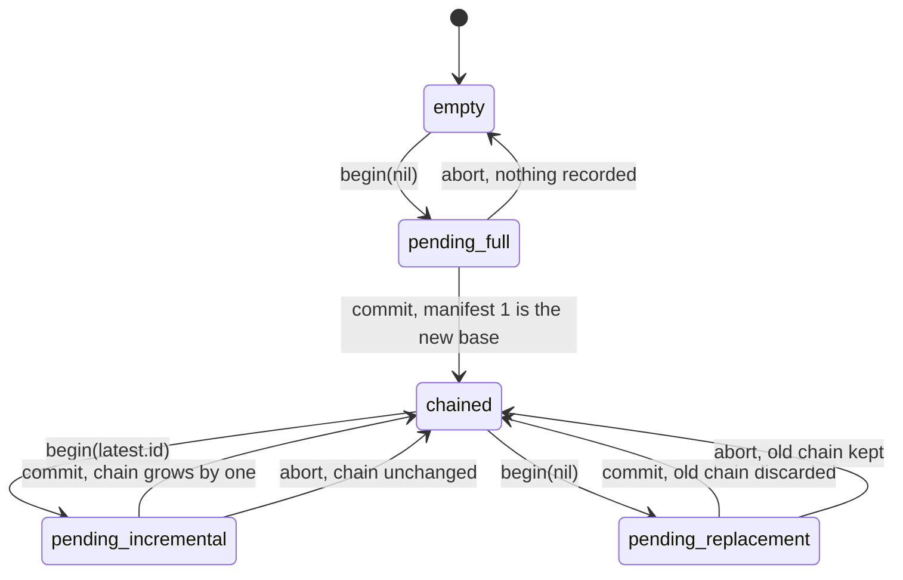
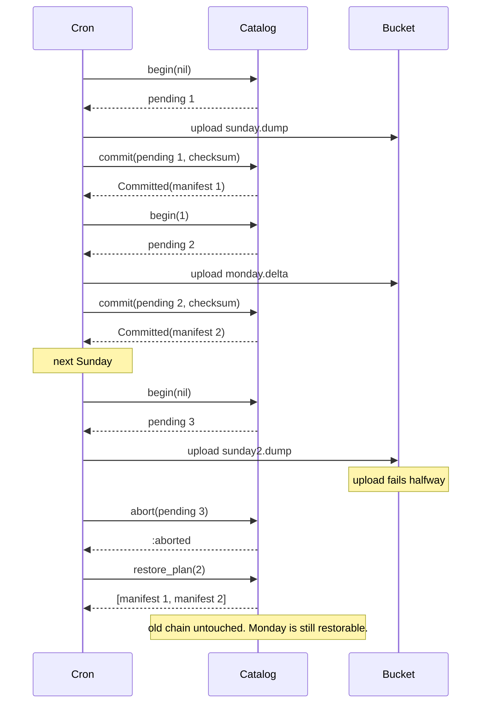

# SnapshotMachines

> Every incremental backup is a promise that the full one still exists. 🗃️

A manifest catalog for Ruby. You tell it when a full snapshot starts and when it lands, and when each incremental one is taken on top. It remembers the chain, refuses to let you build on anything but the latest, keeps the old chain intact until a new full one has actually committed, and answers the only question that matters at 3 AM: to restore *this*, which manifests do I need, and in what order?

## Quick Start

```bash
gem 'snapshot_machines'
```

```ruby
include SnapshotMachines
catalog = Catalog.new

full = catalog.begin(nil)                          # nil means "start a full snapshot"
sunday = catalog.commit(full, checksum_of(sunday_dump)).manifest
# => Manifest(id: SnapshotId(1), base: nil, checksum: ...)

monday = catalog.begin(sunday.id)                  # build on Sunday
monday = catalog.commit(monday, checksum_of(monday_delta)).manifest
# => Manifest(id: SnapshotId(2), base: SnapshotId(1), checksum: ...)

catalog.restore_plan(monday.id)
# => [sunday, monday]
```

Each `Manifest` holds its `SnapshotId`, the `SnapshotId` it builds on, and the checksum you gave it. The restore plan is the list of manifests to replay, oldest first. Anything the catalog won't do comes back as a symbol, never an exception.

## A Message to the Resistance

So you set up backups. Full dump every Sunday, incrementals Monday through Saturday, uploaded to a bucket with a lifecycle rule. Thirty days retention. Very responsible.

Then a Wednesday restore fails. The incrementals from Monday and Tuesday are right there. Wednesday's is there. Sunday's full dump expired at midnight because it was thirty-one days old, and nobody told the lifecycle rule that three other files depend on it.

The bytes were never the problem. The problem is that nothing in your system knew that Wednesday *needs* Sunday. The dependency lived in a naming convention and a vague memory of how the cron job works.

This gem holds that dependency. It won't take the bytes, won't upload anything, won't verify a checksum. It keeps the chain of who-builds-on-whom, and it makes a full replacement wait until the replacement has actually landed, so the old chain is never orphaned by an optimistic cleanup.

## Chapter 1: Stardate 2025.186, the AMS Chandy

> **AMS Chandy**, NCC-4218, *Chandy*-class archive tender.
> Keep the full captain's log, then know exactly which later pages depend on it.

The tender doesn't carry the logs. It carries the index: this page is a complete log, these pages are amendments, each amendment names the page it amends. When a new complete log is being written, the old one stays on the shelf until the new one is bound. When the new one is bound, the old chain and all its amendments are struck from the index together.

An ensign with a disk-space alert suggests:

```ruby
def prune_backups
  Dir["backups/*.dump"].each do |file|
    File.delete(file) if File.mtime(file) < 30.days.ago
  end
end
```

"That," says the archivist, "is how Wednesday becomes unrestorable."

## The Flight Plan



And the week the full dump was replaced:



## How the Catalog Works

### A full snapshot

Pass `nil` to `begin` and you get a `Pending`: the attempt's `SnapshotId` and what it builds on. Nothing is recorded yet. Record it with `commit` and the checksum you computed.

```ruby
catalog = SnapshotMachines::Catalog.new
catalog.latest           # => nil, nothing yet

pending = catalog.begin(nil)
pending.id               # => SnapshotId(raw: 1)
catalog.pending          # => pending, the one open attempt
catalog.commit(pending, 42)   # => Committed(Manifest(SnapshotId(1), nil, 42))
catalog.latest                # => Manifest(SnapshotId(1), nil, 42)
```

A full manifest has `nil` as its base. It depends on nothing.

### An incremental snapshot

Pass the id of the latest manifest and the new one builds on it.

```ruby
monday = catalog.begin(catalog.latest.id)
catalog.commit(monday, 43)    # => Committed(Manifest(SnapshotId(2), SnapshotId(1), 43))

tuesday = catalog.begin(catalog.latest.id)
catalog.commit(tuesday, 44)   # => Committed(Manifest(SnapshotId(3), SnapshotId(2), 44))
```

Only the latest manifest can be built on. Ask to build on 1 now and the answer is `:not_latest`. The chain is a line, not a tree.

```ruby
catalog.begin(SnapshotId.new(1))     # => :not_latest, manifest 1 is no longer the tip
catalog.begin(SnapshotId.new(999))   # => :stale, this catalog never issued it
```

### Restore

`restore_plan` walks back from the manifest you name to the full one it rests on, and hands you the list oldest first.

```ruby
catalog.restore_plan(SnapshotId.new(3))
# => [Manifest(1, nil, 42), Manifest(2, 1, 43), Manifest(3, 2, 44)]

catalog.restore_plan(SnapshotId.new(2))
# => [Manifest(1, nil, 42), Manifest(2, 1, 43)]
```

Replay them in that order and you're at Tuesday.

### Replacing the full snapshot

A new full snapshot starts the same way, with `begin(nil)`. Until it commits, the old chain is exactly where it was.

```ruby
replacement = catalog.begin(nil)
catalog.restore_plan(SnapshotId.new(3))   # => still all three

catalog.commit(replacement, 50)               # => Committed(Manifest(4, nil, 50))
catalog.restore_plan(SnapshotId.new(3))       # => :stale, that chain is gone
catalog.restore_plan(SnapshotId.new(4))       # => [Manifest(4, nil, 50)]
```

The moment the new full lands, every manifest of the old chain stops being restorable through this catalog. That's your signal that the old files can go. Not before.

### Aborting

Upload failed, disk filled up, someone hit Ctrl-C. Tell the catalog.

```ruby
attempt = catalog.begin(nil)
catalog.abort(attempt)        # => :aborted
catalog.abort(attempt)        # => :already_aborted, the retry is safe
catalog.commit(attempt, 51)   # => :stale, an aborted attempt never lands
catalog.latest                # => Manifest(4, nil, 50), unchanged
```

An aborted full attempt leaves the old chain alone. An aborted incremental leaves the chain one link shorter than it would have been. Nothing is ever half-recorded.

### One at a time

While a snapshot is pending, no other can begin. Commit it or abort it first.

```ruby
busy = catalog.begin(catalog.latest.id)
catalog.begin(nil)    # => :busy
catalog.abort(busy)   # => :aborted
```

### Retries

Cron jobs retry. A commit that timed out on the way back can be sent again: the same attempt with the same checksum answers `AlreadyCommitted` with the recorded manifest, as long as that manifest is still in the chain. A different checksum is `:mismatch`; the record stands.

```ruby
attempt = catalog.begin(nil)
catalog.commit(attempt, 60)   # => Committed(Manifest(7, nil, 60))
catalog.commit(attempt, 60)   # => AlreadyCommitted(Manifest(7, nil, 60))
catalog.commit(attempt, 61)   # => :mismatch
```

### Scopes and restarts

Ids are Integers underneath (`SnapshotId#raw`): the catalog's scope in the top 16 bits, a sequence counted from 1 below. Two catalogs in the same scope issue the same ids, so give each catalog whose handles could meet its own scope with `Catalog.with_scope(scope)`. A `Pending` or `SnapshotId` from another scope is `:stale` there, refused before anything is looked up.

A new process starts a new catalog, and a new catalog counts from 1 again. Save `catalog.issued` before you hand an id out, and the chain whenever it changes (`catalog.restore_plan(catalog.latest.id)`, oldest first). Come back with `Catalog.restored(scope, issued, chain)`: the sequence continues where it stopped, so every id from before the restart is known and none is reissued, and the chain is back, so `latest`, `restore_plan`, an incremental of the latest manifest and a retried commit of a manifest still in the chain work as before. No attempt survives: a straggling commit or abort from the old process is `:stale` instead of landing in the new chain. An empty chain restores only the sequence.

```ruby
saved_issued = catalog.issued
saved_chain  = catalog.restore_plan(catalog.latest.id)
# ... the process restarts ...
catalog = SnapshotMachines::Catalog.restored(0, saved_issued, saved_chain)
```

Saved state that cannot exist raises `RangeError`: `issued` past `2**48 - 1`, more than 32 manifests, a manifest id of another scope or past `issued`, a chain that does not start with a full, or a manifest whose base is not the one before it. A non-Array chain or an element that isn't a `Manifest` raises `TypeError`.

## The Rules of the Tender

- **Checksums are Integers** in `0..2**64-1`. The catalog stores the checksum; it never computes or verifies one. Floats and strings raise `TypeError`, negatives raise `RangeError`.
- **Values are valid or do not exist.** `SnapshotId`, `Pending` and `Manifest` are checked by the core when they are built, by you or by the catalog: `SnapshotId.new(0)` (a zero sequence) raises `RangeError`, a `Pending` or `Manifest` whose base is of another scope or not older than its id raises `RangeError`, a bare Integer where a `SnapshotId` belongs raises `TypeError`. Every value class is sealed: subclassing one raises `TypeError` and `allocate` is gone. Sealing stops accidents, not reflection (a named `class X < SnapshotId` still binds `X` before raising, `Data#initialize` can be bound directly, `Marshal.load` skips `initialize`), so the catalog is the authority: it reads only instances of exactly its own classes (a subclass raises `TypeError`) and re-validates each through the core (`RangeError`). A forged value never reaches the catalog, so it never earns a refusal symbol. `Committed` and `AlreadyCommitted` hold exactly a `Manifest`, re-validated the same way.
- **A chain holds 32 links.** At capacity, `begin(latest.id)` answers `:chain_full`. `begin(nil)` still works, so a new full snapshot is always possible.
- **Handles belong to one scope.** A `Pending` from another scope's catalog is `:stale`, never an exception.
- **Refusals are symbols and change nothing.** Only malformed input raises (`TypeError`, `RangeError`), and it raises before the catalog is touched.
- **No clock.** The catalog takes no time and records none.
- **Frozen means frozen.** `freeze` the catalog and `begin`, `commit`, and `abort` all raise `FrozenError`. Reads still work.
- **The binding never loses work.** `begin` and `commit` answer values built by calling their classes' `new`, which is Ruby code, so each decides on a copy of the catalog and keeps it only once the answer exists. If building it raises, that exception propagates and nothing is applied. If it freezes the catalog, `FrozenError`; if it calls back in and changes the catalog, `RuntimeError`; in both cases nothing is applied. The value classes are resolved once, when the extension loads: reassigning a constant later changes nothing the catalog builds or accepts.

### Every answer

A call that is honoured answers with a value. A call that is not honoured answers with one of the refusal symbols below, and only those, and changes nothing. A repeat of something that already holds is honoured, marked *repeat*, and changes nothing either. No answer records the clock: the catalog has none.

| Call | Honoured | Refusals |
| --- | --- | --- |
| `Catalog.new`, `Catalog.with_scope(scope)` | `Catalog` | none (`TypeError`, `RangeError` for a bad scope) |
| `Catalog.restored(scope, issued, chain)` | `Catalog` | none (`RangeError` for saved state that cannot exist, `TypeError` for a chain that isn't an Array of `Manifest`) |
| `begin(base)` | `Pending` | `:stale`, `:busy`, `:not_latest`, `:chain_full`, `:exhausted` |
| `commit(pending, checksum)` | `Committed`, `AlreadyCommitted` (*repeat*) | `:stale`, `:mismatch` |
| `abort(pending)` | `:aborted`, `:already_aborted` (*repeat*) | `:stale`, `:mismatch` |
| `restore_plan(target)` | `Array` of `Manifest`, oldest first | `:stale` |
| `pending`, `latest` | `Pending` / `Manifest`, or `nil` | none |
| `scope`, `issued`, `capacity` | Integer | none |

Each refusal is the snake_case of one core `Refusal` variant. The core's `Undersized` (an output buffer too short for the plan) never reaches Ruby: the gem always passes a full one.

| Refusal | Meaning |
| --- | --- |
| `:stale` | The handle names nothing current here: another scope, never issued, aborted, committed and since replaced, or not in the chain. |
| `:busy` | An attempt is already open. |
| `:not_latest` | The base was issued here but is not the latest committed manifest. |
| `:chain_full` | An incremental of a full chain. |
| `:exhausted` | The scope's 2**48 - 1 ids are spent. |
| `:mismatch` | The id is recorded with a different base or checksum; the record stands. |

The repeats. Only what the catalog can prove from its own state is honoured:

| Repeat | Honoured when | Otherwise |
| --- | --- | --- |
| `commit` | same attempt, same checksum, manifest still in the chain | `:mismatch` for another checksum, `:stale` once the chain was replaced |
| `abort` | the attempt is the most recently aborted one | `:stale` once a newer attempt began (the catalog remembers one abort) |

## What You Think You're Doing vs Reality

### You Think: "The retention policy keeps thirty days of backups."
### Reality: It keeps thirty days of files. Some of those files are useless alone.

An incremental backup is not a backup. It's a diff. Its value is exactly zero without the full snapshot it was taken against, and a retention rule counting days has no idea which file that is. The catalog knows. Ask it before you delete anything.

## What's Yours

The catalog is the index, not the archive. Take the snapshot, compute the checksum, store the bytes somewhere durable, and only then `commit`. Persist the manifests and `catalog.issued` alongside the bytes, because a catalog that lives only in memory forgets the chain with the process; come back with `Catalog.restored` so the chain returns and a pre-restart attempt can't land. When `restore_plan` says a manifest is gone, that's when the corresponding files are safe to remove.

## License

MIT License. See [LICENSE.txt](LICENSE.txt) for details.

**Remember: Sunday's dump was deleted on schedule. Wednesday's restore was not.**
