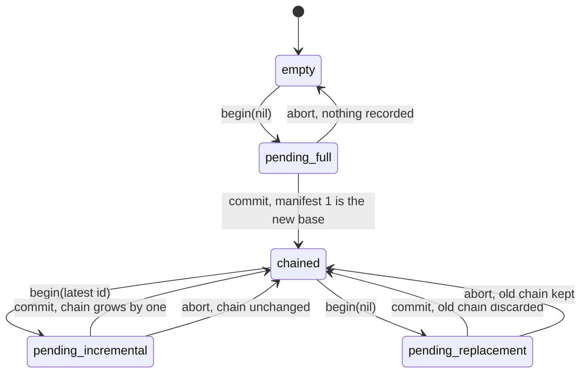
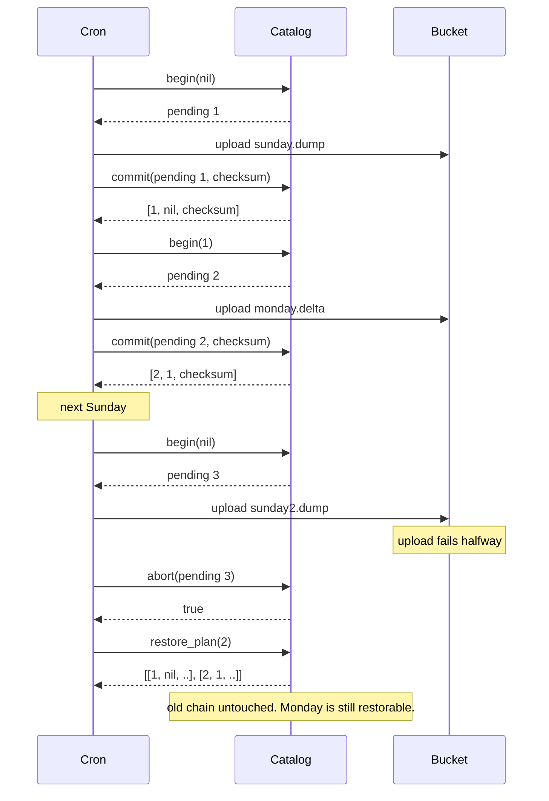

# SnapshotMachines

> Every incremental backup is a promise that the full one still exists. 🗃️

A manifest catalog for Ruby. You tell it when a full snapshot starts and when it lands, and when each incremental one is taken on top. It remembers the chain, refuses to let you build on anything but the latest, keeps the old chain intact until a new full one has actually committed, and answers the only question that matters at 3 AM: to restore *this*, which manifests do I need, and in what order?

## Quick Start

```bash
gem 'snapshot_machines'
```

```ruby
catalog = SnapshotMachines::Catalog.new

full = catalog.begin(nil)                      # nil means "start a full snapshot"
catalog.commit(full, checksum_of(sunday_dump)) # => [1, nil, checksum]

monday = catalog.begin(1)                      # build on manifest 1
catalog.commit(monday, checksum_of(monday_delta)) # => [2, 1, checksum]

catalog.restore_plan(2)
# => [[1, nil, sunday_checksum], [2, 1, monday_checksum]]
```

Each manifest is a three-element array: its id, the id it builds on, and the checksum you gave it. The restore plan is the list of manifests to replay, oldest first.

## A Message to the Resistance

So you set up backups. Full dump every Sunday, incrementals Monday through Saturday, uploaded to a bucket with a lifecycle rule. Thirty days retention. Very responsible.

Then a Wednesday restore fails. The incrementals from Monday and Tuesday are right there. Wednesday's is there. Sunday's full dump expired at midnight because it was thirty-one days old, and nobody told the lifecycle rule that three other files depend on it.

The bytes were never the problem. The problem is that nothing in your system knew that Wednesday *needs* Sunday. The dependency lived in a naming convention and a vague memory of how the cron job works.

This gem holds that dependency. It won't take the bytes, won't upload anything, won't verify a checksum. It keeps the chain of who-builds-on-whom, and it makes a full replacement wait until the replacement has actually landed, so the old chain is never orphaned by an optimistic cleanup.

## Chapter 1: Stardate 2025.186, the AMS Chandy

> **AMS Chandy**, NCC-4218, *Chandy*-class archive tender.
> Keep the full captain's log, then know exactly which later pages depend on it.

The tender doesn't carry the logs. It carries the index: this page is a complete log, these pages are amendments, each amendment names the page it amends. When a new complete log is being written, the old one stays on the shelf until the new one is bound. When the new one is bound, the old chain and all its amendments are struck from the index together.

An ensign with a disk-space alert suggests:

```ruby
def prune_backups
  Dir["backups/*.dump"].each do |file|
    File.delete(file) if File.mtime(file) < 30.days.ago
  end
end
```

"That," says the archivist, "is how Wednesday becomes unrestorable."

## The Flight Plan



And the week the full dump was replaced:



## How the Catalog Works

### A full snapshot

Pass `nil` to `begin` and you get a `Pending` handle. Nothing is recorded yet. Record it with `commit` and the checksum you computed.

```ruby
catalog = SnapshotMachines::Catalog.new
catalog.latest           # => nil, nothing yet

pending = catalog.begin(nil)
pending.id               # => 1
catalog.commit(pending, 42)   # => [1, nil, 42]
catalog.latest                # => [1, nil, 42]
```

A full manifest has `nil` as its base. It depends on nothing.

### An incremental snapshot

Pass the id of the latest manifest and the new one builds on it.

```ruby
monday = catalog.begin(1)
catalog.commit(monday, 43)    # => [2, 1, 43]

tuesday = catalog.begin(2)
catalog.commit(tuesday, 44)   # => [3, 2, 44]
```

Only the latest manifest can be built on. Ask to build on 1 now and the answer is `nil`. The chain is a line, not a tree.

```ruby
catalog.begin(1)     # => nil, manifest 1 is no longer the tip
catalog.begin(999)   # => nil, never heard of it
```

### Restore

`restore_plan` walks back from the manifest you name to the full one it rests on, and hands you the list oldest first.

```ruby
catalog.restore_plan(3)
# => [[1, nil, 42], [2, 1, 43], [3, 2, 44]]

catalog.restore_plan(2)
# => [[1, nil, 42], [2, 1, 43]]
```

Replay them in that order and you're at Tuesday.

### Replacing the full snapshot

A new full snapshot starts the same way, with `begin(nil)`. Until it commits, the old chain is exactly where it was.

```ruby
replacement = catalog.begin(nil)
catalog.restore_plan(3)       # => still [[1, nil, 42], [2, 1, 43], [3, 2, 44]]

catalog.commit(replacement, 50)   # => [4, nil, 50]
catalog.restore_plan(3)           # => nil, that chain is gone
catalog.restore_plan(4)           # => [[4, nil, 50]]
```

The moment the new full lands, every manifest of the old chain stops being restorable through this catalog. That's your signal that the old files can go. Not before.

### Aborting

Upload failed, disk filled up, someone hit Ctrl-C. Tell the catalog.

```ruby
attempt = catalog.begin(nil)
catalog.abort(attempt)    # => true
catalog.abort(attempt)    # => false, already dealt with
catalog.latest            # => [4, nil, 50], unchanged
```

An aborted full attempt leaves the old chain alone. An aborted incremental leaves the chain one link shorter than it would have been. Nothing is ever half-recorded.

### One at a time

While a snapshot is pending, no other can begin. Commit it or abort it first.

```ruby
busy = catalog.begin(4)
catalog.begin(nil)    # => nil
catalog.begin(4)      # => nil
catalog.abort(busy)   # => true
```

## The Rules of the Tender

- **Checksums and ids are Integers** in `0..2**64-1`. The catalog stores the checksum; it never computes or verifies one. Floats and strings raise `TypeError`, negatives raise `RangeError`.
- **A chain holds 32 links.** At capacity, `begin(latest)` returns `nil`. `begin(nil)` still works, so a new full snapshot is always possible.
- **Handles belong to one catalog.** Hand a `Pending` from one catalog to another and you get `ArgumentError`. Commit the same handle twice and the second returns `nil`.
- **Rejections return nil or false.** Only malformed input raises.
- **Frozen means frozen.** `freeze` the catalog and `begin`, `commit`, and `abort` all raise `FrozenError`. Reads still work.

## What You Think You're Doing vs Reality

### You Think: "The retention policy keeps thirty days of backups."
### Reality: It keeps thirty days of files. Some of those files are useless alone.

An incremental backup is not a backup. It's a diff. Its value is exactly zero without the full snapshot it was taken against, and a retention rule counting days has no idea which file that is. The catalog knows. Ask it before you delete anything.

## What's Yours

The catalog is the index, not the archive. Take the snapshot, compute the checksum, store the bytes somewhere durable, and only then `commit`. Persist the catalog's state alongside the bytes, because a catalog that lives only in memory forgets the chain with the process. When `restore_plan` says a manifest is gone, that's when the corresponding files are safe to remove.

## License

MIT License. See [LICENSE.txt](LICENSE.txt) for details.

**Remember: Sunday's dump was deleted on schedule. Wednesday's restore was not.**
